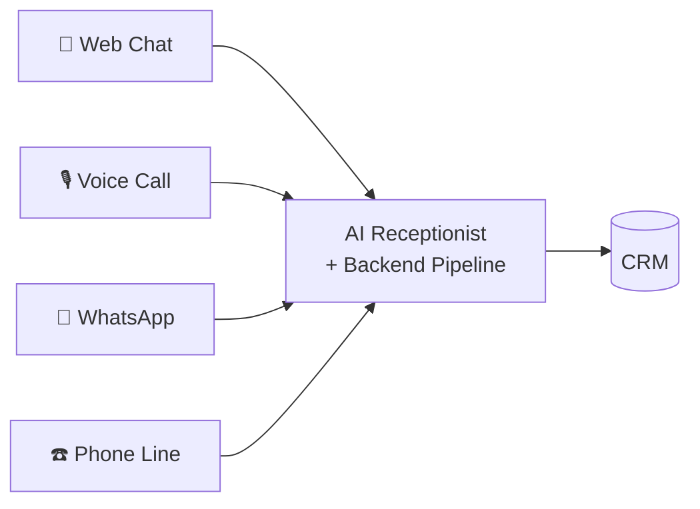
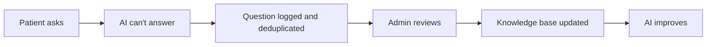
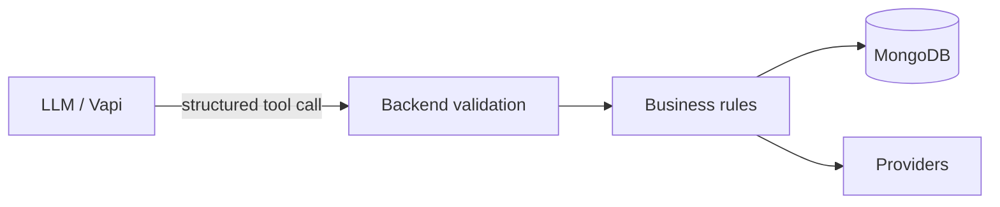

<div align="center">

# 🦷 AI Front Desk & Patient Conversion Platform

### The front desk that never sleeps.

**A multi-tenant SaaS that answers every patient enquiry, books appointments, follows up automatically, and gives clinic owners a full CRM, over chat, voice and WhatsApp.**

Built first for **Indore Poly Dental Clinic**, New Palasia, Indore.

<br/>


<br/>

[Overview](#-overview) ·
[Problem](#-the-problem) ·
[Features](#-features) ·
[Channels](#-channels) ·
[AI Layer](#-ai-layer) ·
[Architecture](#-architecture) ·
[Quick Start](#-quick-start) ·
[Testing](#-testing-checklist) ·
[Roadmap](#-roadmap)

</div>

---

## 📖 Overview

Small clinics lose patients when calls go unanswered, enquiries are not recorded and follow-ups are forgotten. This platform closes that gap.

It is **not just a chatbot**. It is a complete **Patient Opportunity Management System**:

```
Discovery → Conversation → Qualification → Capture → Appointment → Follow-up → Conversion → CRM
```

| | |
|---|---|
| **Customer** | Small and mid-sized appointment-based clinics |
| **First niche** | Dental clinics in Indore, Madhya Pradesh |
| **Anchor clinic** | Indore Poly Dental Clinic, 1/4 near 56 Shops, New Palasia, Indore |
| **Doctors seeded** | Dr. Sandesh Jain (Oral & Maxillofacial Surgeon), Dr. Saumya Jain (Endodontist & Cosmetic Dentist) |
| **Clinic hours** | Mon to Sat, 11:00 AM to 8:30 PM |
| **Core promise** | Every enquiry is answered, captured and followed up |

---

## 🚨 The Problem

Clinics don't lose patients because of bad doctors, bad treatment, high prices or poor reviews. They lose them because **nobody was available**.

| Where it breaks | What happens |
|---|---|
| 📞 Missed calls | Receptionist is busy, or the clinic is closed |
| 📝 Enquiry not recorded | Name, number and requirement are forgotten |
| ⏳ Slow response | The patient calls the next clinic |
| 🔁 No follow-up | "I'll think about it" is never followed up |
| 👁️ No visibility | The owner can't see where patients come from |
| 🧩 Scattered data | Calls, WhatsApp, email and notebooks, none connected |

> One lost patient also means lost family, friends and referrals.

---

## ✨ Features

### 🧑‍⚕️ Patient-facing

| | Feature | Description |
|---|---|---|
| 💬 | **AI chat receptionist** | 24/7 answers grounded only in the clinic's verified information |
| 🎙️ | **AI voice call** | "Talk to Us" button, browser voice powered by Vapi |
| 📱 | **WhatsApp assistant** | Same AI, same pipeline, over WhatsApp |
| 📅 | **Smart booking** | Checks real doctor availability, then books |
| 📧 | **Confirmation emails** | Automatic, with a calendar invite |
| 🌙 | **Landing page** | Doctors, treatments, location and hours, with dark mode |

### 🏥 Clinic-facing

| | Feature | Description |
|---|---|---|
| 🗂️ | **Lead CRM** | Search, filter, pagination, status pipeline, conversation timeline |
| 🎯 | **Intent detection** | General, pricing, treatment, booking, emergency, complaint and more |
| 📊 | **Lead scoring (0 to 100)** | Rule-based and explainable, never guessed by the LLM |
| 👨‍⚕️ | **Doctor routing** | Leads auto-assigned by treatment type |
| 🚨 | **Emergency escalation** | Emergency patterns trigger an instant human handoff |
| 🧑‍💼 | **Handoff queue** | Staff see an AI summary and reply inline |
| ⏰ | **Follow-up engine** | Auto-scheduled, auto-sent, auto-cancelled once booked |
| 🔔 | **Notifications** | Email plus in-dashboard alerts |
| 📈 | **Analytics** | Totals, conversion rate, source attribution |
| ❓ | **Unanswered questions** | Deduplicated log showing where the knowledge base has gaps |
| 📱 | **Responsive dashboard** | Mobile, tablet and desktop |

### 🏢 Platform

| | Feature | Description |
|---|---|---|
| 🏗️ | **Multi-tenant** | Every record scoped by `clinicId`, resolved server-side from the session |
| 🪄 | **Self-signup wizard** | 3-step onboarding that builds a clinic's knowledge base |
| 💳 | **Billing (Razorpay)** | Plans: Free, Starter, Growth, Enterprise (off by default) |
| 🧠 | **RAG knowledge base** | Local embeddings and semantic search (optional) |
| 🔌 | **Provider interfaces** | Email, telephony, WhatsApp and calendar are all swappable |

---

## 📡 Channels

One conversation and lead system, no matter where the patient starts.



| Channel | Powered by | Status |
|---|---|---|
| 💬 Web chat | Claude API | ✅ Live |
| 🎙️ Browser voice call | Vapi | ✅ Live (needs `VAPI_API_KEY`) |
| 📱 WhatsApp | Meta WhatsApp Cloud API | 🔌 Built, behind `WHATSAPP_ENABLED` |
| ☎️ Inbound and outbound phone | Vapi + telephony provider (Exotel via SIP) | 🔌 Built, behind `TELEPHONY_ENABLED` |

**Voice and chat are indistinguishable to the CRM.** A voice transcript becomes Messages on the same Conversation model, and produces the same Lead.

---

## 🧠 AI Layer

### Large language model

The Claude API powers conversation, intent detection, structured extraction and conversation summaries. It is pay-per-token with no subscription.

### Voice (Vapi)

Vapi is the voice brain. A telephony provider is the phone network. They are kept separate on purpose.

```
Vapi = AI voice brain          Telephony provider = actual phone network
```

The voice assistant follows a strict **booking protocol**:

1. Ask the complaint and the preferred date or doctor.
2. Call **`checkAvailableSlots`** and offer 2 to 3 real slots (never assume a slot is free).
3. Collect name, age, 10-digit mobile number and email, one question at a time.
4. Validate everything: 10-digit phone, valid email, Mon to Sat, slot within 11:00 AM to 8:30 PM.
5. **Read all details back** and wait for an explicit yes.
6. Only then call **`bookAppointment`**.

Dynamic variables such as `{{currentDate}}` are injected per call, so the assistant never works from a stale date.

### RAG knowledge base (vector search)

```
Clinic documents → Chunking → Local embeddings → Vector store → Top-k chunks → Claude → Answer
```

| | |
|---|---|
| **Embeddings** | `Xenova/all-MiniLM-L6-v2` via Transformers.js, 384 dimensions, runs locally, no API cost |
| **Retrieval** | Cosine similarity ranking over `KnowledgeChunk` records |
| **Switch** | `KB_MODE=static` (default) or `KB_MODE=vector`, no code change needed |
| **Endpoints** | `/api/rag/chunks`, `/api/rag/query` |

### The unanswered-question feedback loop



Three different phrasings of the same question collapse into one record with `count = 3`.

---

## 🔁 How It Works


**Example journey:** *"I've lost two teeth and want implants. Can I visit tomorrow?"*

1. AI answers from the clinic's verified information.
2. Intent is detected: high-intent treatment enquiry.
3. It checks free slots and offers real options.
4. Patient picks one. Details are collected and read back.
5. Appointment is booked, a confirmation email goes out, the Google Calendar event is created, and the lead lands in the CRM with a score and the right doctor assigned.

---

## 📅 Appointments & Google Calendar

- Availability is checked against the internal `Appointment` model before any slot is offered.
- With `CALENDAR_SYNC_ENABLED=true`, each clinic connects its **own** Google account through OAuth. Booking, rescheduling and cancelling mirror to the doctor's Google Calendar (`calendarEventId` is stored on the appointment).
- If the calendar is disconnected or fails, booking still works internally and the request is kept for manual confirmation.

Statuses: `Requested` · `Confirmed` · `Rescheduled` · `Cancelled` · `Completed` · `No Show`

---

## ⏰ Follow-up Engine

| Rule | Behaviour |
|---|---|
| Auto-schedule | Leads scoring 31 to 80 with no appointment get a follow-up 2 days out |
| Daily dispatch | `node-cron` sends due follow-ups, one failure never stops the batch |
| Auto-cancel | Booking an appointment or marking a lead Lost cancels pending follow-ups |
| Channels | `email` today, `call` supported for outbound voice follow-ups |
| Dashboard | "Follow-ups due today" widget links straight to the lead |

---

## 🧑‍💼 Human Handoff

**Triggers:** AI fallback response · patient asks for a human · emergency pattern matched (config file, not hard-coded).

**On escalation:**
1. `needsHuman` is set on the conversation.
2. Staff are emailed and a dashboard notification is created.
3. The Handoff Queue shows the patient, reason and an AI-written summary.
4. Staff reply inline. The message is appended to the same thread and `needsHuman` clears.

The patient never has to repeat themselves.

---

## 🎯 Lead Scoring

Scores come from a fixed rubric in code, so they are consistent and explainable.

| Signal | Points |
|---|:---:|
| Appointment requested | +30 |
| Phone number captured | +15 |
| Specific treatment named | +15 |
| Urgent requirement | +15 |
| Preferred date provided | +10 |
| High-value treatment | +10 |
| General information only | +5 |

| Score | Level |
|:---:|---|
| 0 – 30 | 🟢 Low |
| 31 – 60 | 🟡 Medium |
| 61 – 80 | 🟠 High |
| 81 – 100 | 🔴 Very High |

**Lead pipeline:** New → Contacted → Qualified → Appointment Requested → Appointment Booked → Visited → Treatment Started → Follow-up Required → Converted / Lost

---

## 🏗️ Architecture

> **The LLM is an intelligence layer, not the source of truth.** It never touches the database. It requests a tool, the backend validates it, and only then does anything change.



### Provider abstraction

Every external service sits behind an interface. If one fails or is switched off, **lead capture never breaks**.

| Interface | Default | Pluggable with |
|---|---|---|
| `EmailService` | Nodemailer (SMTP) | Resend, SendGrid, Amazon SES |
| `TelephonyProvider` | `NullTelephonyProvider` | `ExotelProvider`, any SIP provider |
| `WhatsAppProvider` | `NullWhatsAppProvider` | `MetaWhatsAppProvider` |
| `CalendarProvider` | `NullCalendarProvider` | `GoogleCalendarProvider` |

### Fallback-first design

| If this fails | This still works |
|---|---|
| Vapi | Chat continues |
| Telephony | Browser voice and chat |
| Email | Lead is stored, notification retried |
| WhatsApp | Lead creation unaffected |
| Google Calendar | Appointment request stored for manual confirmation |

### Multi-tenancy

- Every clinic-owned document carries a `clinicId`.
- `tenantMiddleware` resolves `clinicId` from the logged-in admin's session, **never from a request parameter**, so one clinic can never read another's data.

### Data model

| Collection | Purpose |
|---|---|
| `Clinic` | Profile, slug, plan, subscription status, staff and their treatments |
| `Lead` | Score, intent, source, status, `assignedTo`, summary |
| `Conversation` / `Message` | Every chat, voice and WhatsApp exchange, `needsHuman`, escalation reason |
| `Appointment` | Slot, doctor, status, `calendarEventId` |
| `FollowUp` | Scheduled date, status, channel |
| `UnansweredQuestion` | Deduplicated question and count |
| `Notification` | In-app alerts |
| `KnowledgeChunk` | Text chunk plus embedding for RAG |

### Project structure

```
AI_Help_Desk/
├── client/                  React + TypeScript + Vite
│   └── src/
│       ├── components/      Reusable UI, VoiceCallModal
│       ├── pages/           Landing, Dashboard, Leads, Analytics, Onboarding...
│       ├── features/        auth, leads, conversations, appointments...
│       └── services/        API clients
├── server/                  Node + Express + TypeScript
│   └── src/
│       ├── modules/         auth, clinics, leads, conversations, appointments,
│       │                    followUps, notifications, analytics
│       ├── ai/              aiService, prompts, tools, knowledge, embeddings
│       ├── integrations/    email, telephony, whatsapp, calendar, billing
│       ├── middleware/      auth, tenant scoping, validation
│       └── config/
└── shared/                  Shared types and constants
```

---

## 🧰 Tech Stack

| Layer | Technology |
|---|---|
| **Frontend** | React, TypeScript, Vite, Tailwind CSS, React Router, Axios, Lucide Icons, toast notifications |
| **Backend** | Node.js, Express, TypeScript, REST APIs, webhooks |
| **Database** | MongoDB Atlas, Mongoose |
| **LLM** | Claude API |
| **Voice** | Vapi (web call), Exotel via SIP (optional) |
| **Messaging** | WhatsApp Cloud API (Meta) |
| **Calendar** | Google Calendar API (OAuth per clinic) |
| **Embeddings / RAG** | Transformers.js, `Xenova/all-MiniLM-L6-v2` |
| **Email** | Nodemailer over SMTP |
| **Scheduling** | node-cron |
| **Billing** | Razorpay |
| **Security** | JWT, bcrypt, Helmet, CORS, rate limiting, input validation |

---

## 🌐 API Overview

| Area | Route |
|---|---|
| Voice | `/api/telephony` (`web-call`, `webhooks`, `outbound-call`) |
| Telephony webhook | `/api/webhooks/telephony` (signature check, deduped by `providerCallId`) |
| WhatsApp webhook | WhatsApp routes (inbound messages create conversations and leads) |
| Onboarding | `/api/onboarding` |
| RAG | `/api/rag/chunks`, `/api/rag/query` |
| Analytics | `/analytics/summary`, `/analytics/by-source` |

---

## 🛡️ Safety & Security

**AI safety**
1. **Verified information only.** Answers come from the clinic's approved knowledge base.
2. **No hallucination.** If unsure: *"Let me connect you with the clinic team."*
3. **Controlled actions.** The AI requests tools, the backend validates and executes.
4. **Human escalation** for emergencies, complaints and low-confidence answers.
5. **Privacy.** Only data needed for the workflow is collected.
6. **Read-back before booking** on voice, so misheard numbers and emails are caught.

> The AI runs the **front desk**. It never makes medical decisions.

**Application security:** JWT auth · password hashing · role-based protected routes · input validation · rate limiting · CORS · Helmet · webhook signature verification and idempotency · secrets only in environment variables.

---

## 🚀 Quick Start

### Prerequisites

- Node.js 18 or higher
- MongoDB Atlas free cluster (or local MongoDB)
- SMTP account (a Gmail app password works)
- Optional: Claude API key, Vapi key, Meta WhatsApp Cloud API test number, Google OAuth credentials

### Install

```bash
git clone https://github.com/raghvendrapratap1/AI_Help_Desk.git
cd AI_Help_Desk

cd server && npm install
cd ../client && npm install
```

### Configure

```bash
cd server
cp .env.example .env
# fill in your own values
```

### Run

```bash
# Terminal 1: backend
cd server && npm run dev

# Terminal 2: frontend
cd client && npm run dev
```

| Service | URL |
|---|---|
| Frontend | http://localhost:5173 |
| Backend | http://localhost:5000 |
| Clinic onboarding | http://localhost:5173/onboard |

---

## 🔐 Environment Variables

Create `server/.env`. **Never commit this file.** Make sure `.env` is in `.gitignore`.

<details>
<summary><b>Click to expand the full list</b></summary>

```env
# ── Core ───────────────────────────────────
PORT=5000
NODE_ENV=development
CLIENT_URL=http://localhost:5173
MONGODB_URI=<your-mongodb-connection-string>
JWT_SECRET=<long-random-string>

# ── Email (SMTP) ───────────────────────────
SMTP_HOST=smtp.gmail.com
SMTP_PORT=587
SMTP_USER=<your-email>
SMTP_PASS=<app-password>
SMTP_FROM="Clinic Name <your-email>"

# ── AI ─────────────────────────────────────
ANTHROPIC_API_KEY=<your-key>
VAPI_API_KEY=<your-key>
VAPI_ASSISTANT_ID=<your-assistant-id>

# ── Feature flags ──────────────────────────
TELEPHONY_ENABLED=false
WHATSAPP_ENABLED=false
CALENDAR_SYNC_ENABLED=false
BILLING_ENABLED=false
KB_MODE=static
```

Add provider credentials (Exotel, Meta WhatsApp, Google OAuth, Razorpay) only when you switch the matching flag on.

</details>

### Feature flags

| Flag | Values | Default | Effect when on |
|---|---|:---:|---|
| `TELEPHONY_ENABLED` | `true` / `false` | `false` | Real phone provider (inbound and outbound) |
| `WHATSAPP_ENABLED` | `true` / `false` | `false` | WhatsApp channel |
| `CALENDAR_SYNC_ENABLED` | `true` / `false` | `false` | Mirrors bookings to Google Calendar |
| `BILLING_ENABLED` | `true` / `false` | `false` | Razorpay subscriptions |
| `KB_MODE` | `static` / `vector` | `static` | Switches knowledge retrieval mode |

> **Rule for every flag:** when it is off, the app behaves exactly as it did before the feature existed. No errors, no dead UI.

---

## ✅ Testing Checklist

| Area | How to verify |
|---|---|
| Escalation | Send an emergency message, confirm `needsHuman: true`, an email, and a queue entry |
| Staff reply | Reply inline, confirm the message appends and `needsHuman` clears |
| Follow-up schedule | Create a score-70 lead with no appointment, confirm a follow-up at +2 days |
| Follow-up dispatch | Set `scheduledFor` to now, run the job, confirm status flips to `sent` |
| Follow-up cancel | Book an appointment, confirm the pending follow-up becomes `cancelled` |
| Analytics | Compare `/analytics/summary` and `/analytics/by-source` with manual counts |
| Deduplication | Ask one unknown question 3 ways, confirm a single row with `count = 3` |
| Voice | Click "Talk to Us", complete a call, confirm a lead matching a chat lead |
| Multi-tenant | Create a second clinic, confirm neither admin can see the other's data |
| RAG | Switch `KB_MODE=vector`, ask from a long document, then switch back to `static` |
| WhatsApp | Message the test number, confirm a conversation and lead appear |
| Calendar | Book and cancel, confirm the event appears and disappears in Google Calendar |
| Routing | "Root canal" goes to Dr. Saumya Jain, "jaw trauma" to Dr. Sandesh Jain |
| Builds | `tsc` and `vite build` both exit with 0 errors |

---

## 🗺️ Roadmap

**Done**
- [x] AI chat receptionist with verified knowledge base
- [x] Lead capture, intent detection, rule-based scoring and CRM
- [x] Appointment booking with real availability checks
- [x] Email notifications, human handoff and follow-up engine
- [x] Analytics, source attribution and unanswered-questions log
- [x] Web voice calls (Vapi) with a safe booking protocol
- [x] Multi-tenant onboarding and tenant isolation
- [x] RAG with local embeddings
- [x] WhatsApp, Google Calendar and doctor routing (behind flags)
- [x] Responsive UI

**Next**
- [ ] Real inbound and outbound phone line
- [ ] WhatsApp booking and self-service rescheduling
- [ ] Doctor companion app
- [ ] Multi-language voice (Hindi, Hinglish, Marathi, Gujarati)
- [ ] Patient portal and post-visit feedback
- [ ] Multi-location clinics
- [ ] White-label for other appointment-based businesses

---

## 🤝 Contributing

This is a personal product build. Issues and suggestions are welcome through GitHub Issues.

---

<div align="center">

**Built by [Raghvendra Pratap Singh](https://github.com/raghvendrapratap1)**

*Capture the opportunity first. Automate everything possible afterward.*

</div>
