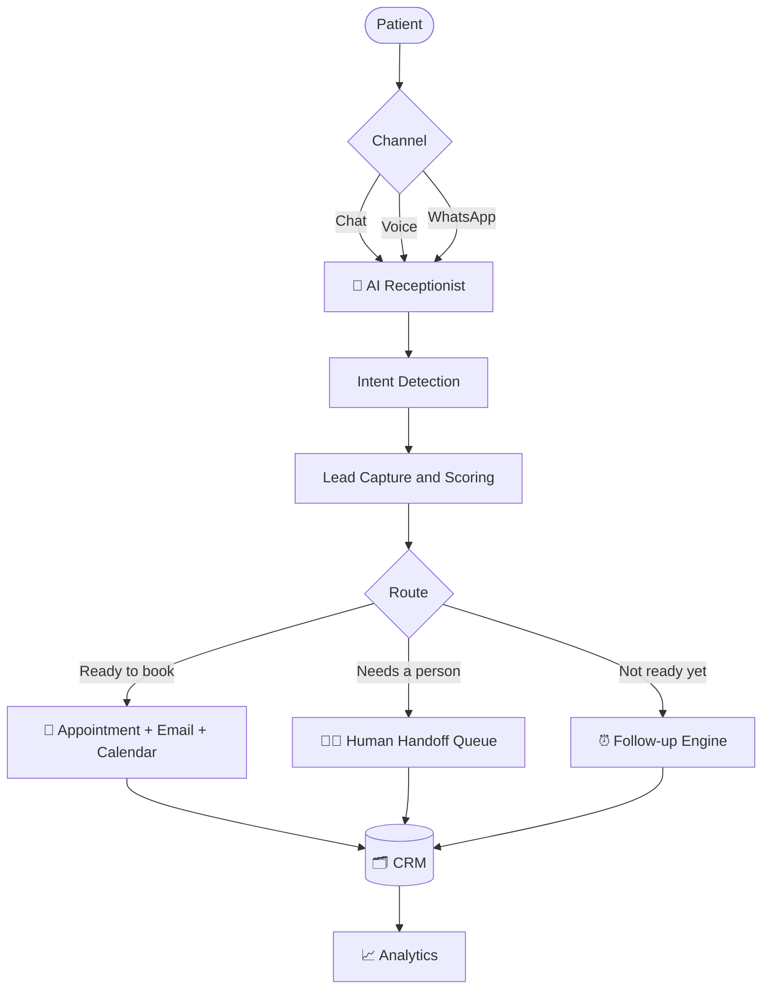
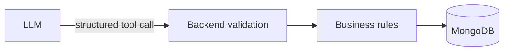

<div align="center">

# 🦷 AI Front Desk & Patient Conversion Platform

### Never lose a patient enquiry.

A 24/7 AI receptionist, lead pipeline and CRM for small and mid-sized clinics.<br/>
Built first for **Indore Poly Dental Clinic**, New Palasia, Indore.

<br/>


[The Problem](#-the-problem) ·
[Features](#-features) ·
[How It Works](#-how-it-works) ·
[Architecture](#-architecture) ·
[Quick Start](#-quick-start) ·
[Roadmap](#-roadmap)

</div>

---

## 📖 Overview

Small clinics lose patients when calls go unanswered, enquiries are not recorded and follow-ups are forgotten. This platform fixes that gap.

It is **not just a chatbot**. It is a complete **Patient Opportunity Management System**:

```
Discovery → Conversation → Qualification → Capture → Appointment → Follow-up → Conversion → CRM
```

| | |
|---|---|
| **Customer** | Small and mid-sized appointment-based clinics |
| **First niche** | Dental clinics in Indore, Madhya Pradesh |
| **Anchor clinic** | Indore Poly Dental Clinic (Dr. Sandesh Jain, Dr. Saumya Jain) |
| **Core promise** | Every enquiry is answered, captured and followed up |

---

## 🚨 The Problem

Clinics are not losing patients because of bad doctors, bad treatment, high prices or poor reviews. They lose them because **nobody was available**.

| Where it breaks | What happens |
|---|---|
| 📞 Missed calls | Receptionist is busy, or the clinic is closed |
| 📝 Enquiry not recorded | Name, number and requirement are forgotten |
| ⏳ Slow response | The patient calls the next clinic |
| 🔁 No follow-up | "I'll think about it" is never followed up |
| 👁️ No visibility | The owner cannot see what is happening |

> One lost patient also means lost family, friends and referrals.

---

## ✨ Features

### Patient-facing

| | Feature | Description |
|---|---|---|
| 💬 | **AI chat receptionist** | 24/7 answers, grounded only in the clinic's verified information |
| 🎙️ | **Voice call (web)** | Talk to the AI from the browser, powered by Vapi |
| 📅 | **Appointment booking** | Checks real doctor availability before confirming a slot |
| 📧 | **Confirmation emails** | Sent automatically after booking |

### Clinic-facing

| | Feature | Description |
|---|---|---|
| 🎯 | **Intent detection** | General, pricing, booking, emergency and more |
| 📊 | **Lead scoring (0 to 100)** | Rule-based and predictable, never guessed by the LLM |
| 🗂️ | **Lead CRM** | Search, filters, status pipeline and conversation timeline |
| 👨‍⚕️ | **Doctor routing** | Leads auto-assigned by treatment type |
| 🚨 | **Emergency escalation** | Emergency keywords trigger an instant human handoff |
| 🧑‍💼 | **Handoff queue** | Staff get an AI summary and reply inline |
| ⏰ | **Follow-up engine** | Auto-scheduled, auto-sent, auto-cancelled once booked |
| 📈 | **Analytics** | Totals, conversion rate, source attribution, traffic |
| ❓ | **Unanswered questions** | Shows exactly where the knowledge base has gaps |
| 🏢 | **Multi-tenant** | Every record scoped by `clinicId`, with a self-signup wizard |
| 📱 | **Responsive UI** | Works on mobile, tablet and desktop |

### 🔌 Built but switched off by default

These sit behind feature flags. With all of them off, the product still works end to end (chat, CRM, booking, follow-ups).

| Feature | Flag |
|---|---|
| Real phone numbers (inbound and outbound) | `TELEPHONY_ENABLED` |
| WhatsApp channel | `WHATSAPP_ENABLED` |
| Google Calendar sync | `CALENDAR_SYNC_ENABLED` |
| Razorpay subscriptions | `BILLING_ENABLED` |
| Vector knowledge base (RAG) | `KB_MODE=vector` |

---

## 🔁 How It Works



**Example:** a patient writes *"I've lost two teeth and want implants. Can I visit tomorrow?"*

1. The AI answers from the clinic's verified information.
2. Intent is detected as a high-intent treatment enquiry.
3. It checks free slots and offers 2 to 3 options.
4. The patient picks one. Name, age, phone and email are collected and read back.
5. The appointment is booked, a confirmation email goes out, and the lead lands in the CRM with a score and the right doctor assigned.

---

## 🏗️ Architecture

> **Core rule: the LLM is an intelligence layer, not the source of truth.**
> It never touches the database. It requests a tool, the backend validates it, and only then does anything change.



**Integrations are plug-ins, not dependencies.** Every external service sits behind an interface, so a failure or a swap never breaks lead capture.

| Interface | Default | Can be swapped for |
|---|---|---|
| `EmailService` | Nodemailer (SMTP) | Resend, SendGrid, Amazon SES |
| `TelephonyProvider` | Null provider | Exotel or any SIP provider |
| `WhatsAppProvider` | Null provider | Meta WhatsApp Cloud API |
| `CalendarProvider` | Null provider | Google Calendar |

**Fallback-first design:** if Vapi fails, chat continues. If email fails, the lead is still stored. If the calendar fails, the appointment request is kept for manual confirmation.

### Project structure

```
AI_Help_Desk/
├── client/                  React + TypeScript + Vite
│   └── src/
│       ├── components/      Reusable UI
│       ├── pages/           Landing, Dashboard, Leads, Analytics...
│       ├── features/        auth, leads, conversations, appointments...
│       └── services/        API clients
├── server/                  Node + Express + TypeScript
│   └── src/
│       ├── modules/         auth, clinics, leads, conversations,
│       │                    appointments, followUps, notifications, analytics
│       ├── ai/              agents, tools, prompts, knowledge
│       ├── integrations/    email, telephony, whatsapp, calendar
│       ├── middleware/      auth, tenant scoping, validation
│       └── config/
└── shared/                  Shared types and constants
```

---

## 🧰 Tech Stack

| Layer | Technology |
|---|---|
| **Frontend** | React, TypeScript, Vite, Tailwind CSS, React Router, Axios, Lucide Icons |
| **Backend** | Node.js, Express, TypeScript, REST APIs, Webhooks |
| **Database** | MongoDB, Mongoose |
| **AI** | Claude API (chat, intent, summaries), Vapi (voice), Transformers.js (local embeddings) |
| **Email** | Nodemailer over SMTP |
| **Scheduling** | node-cron |
| **Integrations** | Google Calendar API, WhatsApp Cloud API, Razorpay |
| **Security** | JWT, bcrypt, Helmet, CORS, rate limiting, input validation |

---

## 🎯 Lead Scoring

Scores come from a fixed rubric in code, so they are consistent and explainable.

| Signal | Points |
|---|:---:|
| Appointment requested | +30 |
| Phone number captured | +15 |
| Specific treatment named | +15 |
| Urgent requirement | +15 |
| Preferred date provided | +10 |
| High-value treatment | +10 |
| General information only | +5 |

| Score | Level |
|:---:|---|
| 0 – 30 | 🟢 Low |
| 31 – 60 | 🟡 Medium |
| 61 – 80 | 🟠 High |
| 81 – 100 | 🔴 Very High |

---

## 🛡️ AI Safety Principles

1. **Verified information only.** Answers come from the clinic's approved knowledge base.
2. **No hallucination.** If unsure, it says: *"Let me connect you with the clinic team."*
3. **Controlled actions.** The AI requests a tool. The backend validates and executes.
4. **Human escalation.** Emergencies, complaints and low-confidence answers go to staff.
5. **Privacy.** Only data needed for the workflow is collected.
6. **Auditability.** Important actions are logged.

> The AI runs the **front desk**. It never makes medical decisions.

---

## 🚀 Quick Start

### Prerequisites

- Node.js 18 or higher
- A MongoDB Atlas free cluster (or local MongoDB)
- An SMTP account (a Gmail app password works)

### Install

```bash
git clone https://github.com/raghvendrapratap1/AI_Help_Desk.git
cd AI_Help_Desk

cd server && npm install
cd ../client && npm install
```

### Configure

```bash
cd server
cp .env.example .env
# then fill in your own values
```

### Run

```bash
# Terminal 1: backend
cd server
npm run dev

# Terminal 2: frontend
cd client
npm run dev
```

| Service | URL |
|---|---|
| Frontend | http://localhost:5173 |
| Backend | http://localhost:5000 |

---

## 🔐 Environment Variables

Create `server/.env`. **Never commit this file.** Make sure `.env` is listed in `.gitignore`.

```env
# ── Core ───────────────────────────────────
PORT=5000
NODE_ENV=development
CLIENT_URL=http://localhost:5173
MONGODB_URI=<your-mongodb-connection-string>
JWT_SECRET=<long-random-string>

# ── Email (SMTP) ───────────────────────────
SMTP_HOST=smtp.gmail.com
SMTP_PORT=587
SMTP_USER=<your-email>
SMTP_PASS=<app-password>
SMTP_FROM="Clinic Name <your-email>"

# ── AI ─────────────────────────────────────
ANTHROPIC_API_KEY=<your-key>
VAPI_API_KEY=<your-key>
VAPI_ASSISTANT_ID=<your-assistant-id>

# ── Feature flags ──────────────────────────
TELEPHONY_ENABLED=false
WHATSAPP_ENABLED=false
CALENDAR_SYNC_ENABLED=false
BILLING_ENABLED=false
KB_MODE=static
```

### Feature flags

| Flag | Values | Default | Effect when on |
|---|---|:---:|---|
| `TELEPHONY_ENABLED` | `true` / `false` | `false` | Uses a real phone provider |
| `WHATSAPP_ENABLED` | `true` / `false` | `false` | Enables the WhatsApp channel |
| `CALENDAR_SYNC_ENABLED` | `true` / `false` | `false` | Mirrors bookings to Google Calendar |
| `BILLING_ENABLED` | `true` / `false` | `false` | Enables Razorpay subscriptions |
| `KB_MODE` | `static` / `vector` | `static` | Switches knowledge retrieval mode |

---

## 🗺️ Roadmap

- [x] AI chat receptionist with verified knowledge base
- [x] Lead capture, scoring and CRM
- [x] Appointment booking with availability checks
- [x] Human handoff and follow-up engine
- [x] Analytics and unanswered-questions log
- [x] Multi-tenant clinic onboarding
- [x] Web voice calls (Vapi)
- [ ] Real inbound and outbound phone calling
- [ ] WhatsApp booking and self-service rescheduling
- [ ] Doctor companion app
- [ ] Multi-language voice (Hindi, Hinglish, Marathi, Gujarati)
- [ ] Patient portal and post-visit feedback
- [ ] Multi-location support
- [ ] White-label for other appointment-based businesses

---

## 🤝 Contributing

This is a personal product build. Issues and suggestions are welcome through GitHub Issues.

---

<div align="center">

**Built by [Raghvendra Pratap Singh](https://github.com/raghvendrapratap1)**

*Capture the opportunity first. Automate everything possible afterward.*

</div>
